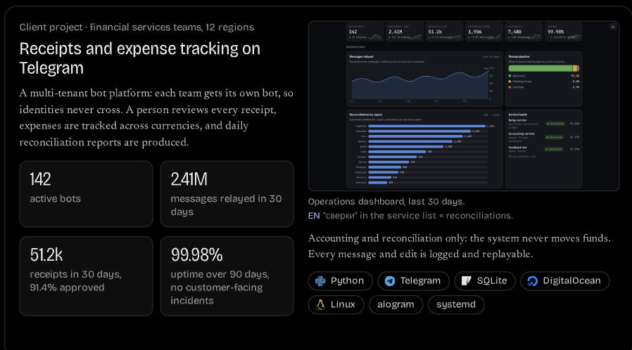
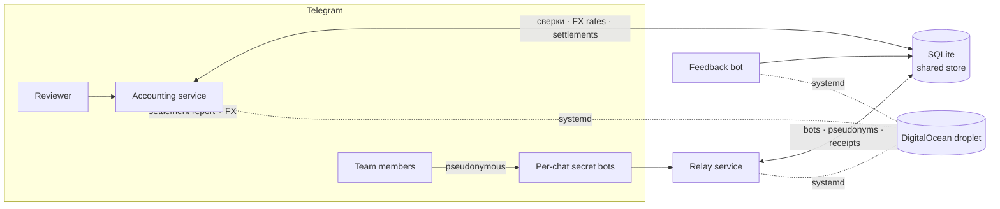

# Receipts & Expense Tracking on Telegram

> A multi-tenant Telegram bot platform for financial-services teams. Each team gets its
> own bot, so identities never cross. A person reviews every receipt, expenses are
> tracked across currencies, and daily reconciliation reports are produced automatically.

**Accounting and reconciliation only — the system never moves funds.** Every message and
edit is logged and replayable.

  

  <a href="#architecture">Architecture</a> ·
  <a href="#features">Features</a> ·
  <a href="dashboard/index.html">Live dashboard demo</a> ·
  <a href="docs/architecture.md">Design notes</a>

---

## What it does

Distributed teams needed to collect payment receipts, keep a clean audit trail, and get a
single daily settlement report per region — all inside Telegram, where the teams already
work. The platform is three cooperating services built and operated solo.

- **Private relay bots.** An admin bot spawns a dedicated "secret" bot per chat. People
  join only through role-scoped invite links and operate under a pseudonym; participants
  never see each other's real accounts or Telegram identities.
- **Receipt pipeline.** A receipt can be a number, a photo, or a photo with a caption.
  It's parsed, broadcast to reviewers, approved or declined, and kept in a replayable log.
- **Automated reconciliation.** At each shift close the accounting bot aggregates the
  day's approved receipts per team and region, applies the right FX rate and commission,
  and posts one formatted settlement report ("сверка") to the bound chat.
- **Pinned payment details.** When a team's requisites change, the current details are
  pushed and pinned for every participant instantly, so money never lands on a stale card.

> Figures shown in the dashboard are illustrative sample data — see
> [Data & privacy](#data--privacy).

| Metric | Value |
|---|---|
| Active bot instances | 142 |
| Messages relayed / 30d | 2.41M |
| Receipts processed / 30d | 51.2k |
| Reconciliations / 30d | 1,906 |
| Uptime (90d) | 99.98% |
| Operating regions | 12 |

## Features

- **Multi-tenant isolation** — one bot per chat, pseudonymous participants, per-chat
  admins / handlers / watchers.
- **Role-based invites** — invite links that grant a role on join; expiry and single-use
  options.
- **Receipt capture & review** — amount/comment parsing, photo and photo-with-caption
  receipts, approve / decline / undo with full history.
- **Multi-currency reconciliation** — 12 regional currencies, per-group commission,
  manual and automated reports sharing one template.
- **Shift scheduling** — per-chat working hours (including overnight and 24h shifts) drive
  which calendar day each report belongs to.
- **Automated FX broadcasts** — rates pushed to bound chats right after each reconciliation,
  per-group toggle.
- **Auto-pinned requisites** — change once, pinned for everyone, old details removed so no
  one pays into a dead account.
- **Idempotent migrations & persistence** — schema evolves in place; message maps, pins,
  and audit logs survive restarts.

## Architecture

Three systemd services on a single DigitalOcean droplet, sharing one SQLite database.

- **Relay service** (`python-telegram-bot`) — the admin bot plus every spawned secret bot,
  pseudonyms, receipts, invites, requisites, shifts.
- **Accounting service** (`python-telegram-bot`) — reconciliation, FX rates, groups, and
  multi-chat regional settlement; reads the relay's data, owns the accounting tables.
- **Feedback bot** (`aiogram`) — lightweight intake and routing.

More detail in [docs/architecture.md](docs/architecture.md).

## Tech stack

**Python 3.12** · **python-telegram-bot 21** · **aiogram 3** · **SQLite** (single shared
store) · **systemd** (service management, auto-restart) · **DigitalOcean** (Ubuntu droplet) ·
hand-rolled **SVG dashboard** (no chart dependencies).

## Live dashboard demo

The operations dashboard in the preview is a self-contained HTML file — open
[`dashboard/index.html`](dashboard/index.html) in a browser, or host it with GitHub Pages.
It's responsive, theme-aware (light/dark), and draws every chart as inline SVG with no
external libraries. All numbers are sample data generated deterministically.

## Data & privacy

This repository is a **portfolio case study**. It intentionally contains **no production
source, secrets, credentials, databases, or real user data** — the live system handles a
client's confidential operations. Everything shown (metrics, regions, charts) is
illustrative sample data created for presentation. The platform performs accounting and
reconciliation only and never holds or moves funds.

## About

Designed, built, and operated end to end by a single developer: product, bot logic, data
model, deployment, and ongoing feature work driven directly by client feedback.
